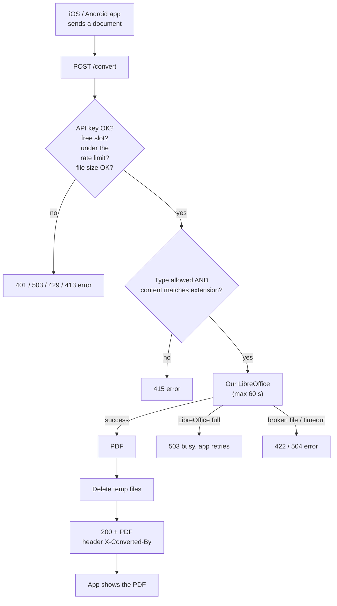
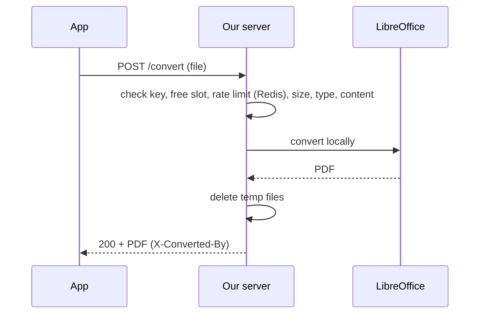
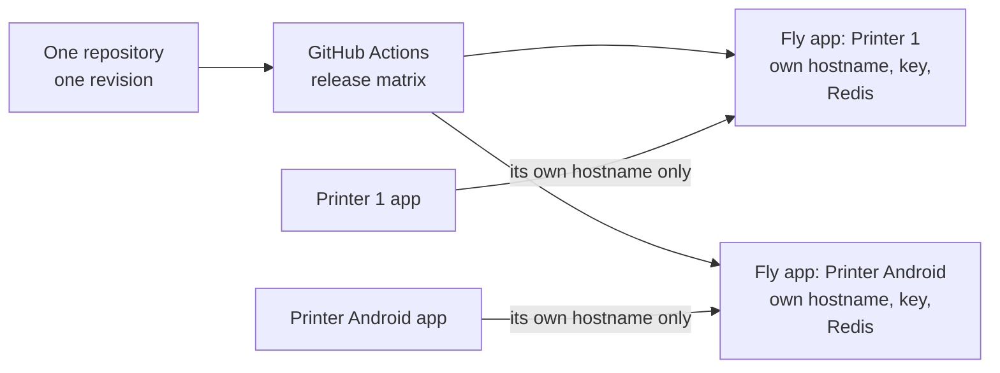

# How it works

> **PDF version (4 pages, easy to share):** [AirPrinter-Converter-Diagrams.pdf](AirPrinter-Converter-Diagrams.pdf)
> Pages: 1. Overview, 2. Request sequence, 3. Scaling, 4. Where user data goes. Sources: [diagrams/](diagrams/).

## In one picture

## Step by step (happy path)

## Two products, two separate servers

Printer 1 and Printer Android must not share a public conversion API. We keep **one repository** and deploy the **same revision** to **two Fly.io apps**. Each has its own hostname, `API_KEY` and Upstash Redis database. Steps: [DEPLOY_FLY.md](DEPLOY_FLY.md) (prepared, not tested yet).

## Who does what

| Part | Job |
|---|---|
| App (iOS / Android) | Picks the file, uploads it, shows the PDF or the error. Retries after 503. Does not send PDF files |
| Our server (Node + Express) | Checks the file, runs LibreOffice, returns the PDF |
| Upstash Redis | Counts requests per device for the rate limit. Shared by all server copies |
| LibreOffice | **The only engine.** Runs on our server. Free, but uses our CPU and RAM |

## Limits (all can be changed)

| Limit | Value | Setting |
|---|---|---|
| File size | 50 MB | `MAX_FILE_MB` |
| Requests at the same time | 10 | `MAX_UPLOADS` |
| Total size of files at the same time | 500 MB | `MAX_UPLOAD_MB_TOTAL` |
| LibreOffice jobs at the same time | 2 | `MAX_CONCURRENT` |
| Requests per device per minute | 10 | `RATE_LIMIT_PER_MINUTE` |
| Requests per device per day | 500 | `RATE_LIMIT_PER_DAY` |
| Over a size / count limit | `503` + `Retry-After` | |
| Over a rate limit | `429` + `Retry-After` | |

## Why only LibreOffice
- Files never leave our server, which keeps privacy simple.
- No cost per file and no third-party account.

## Where the file goes
1. Phone → our server (HTTPS)
2. Our server → phone (PDF)

Our server deletes the file right after.
